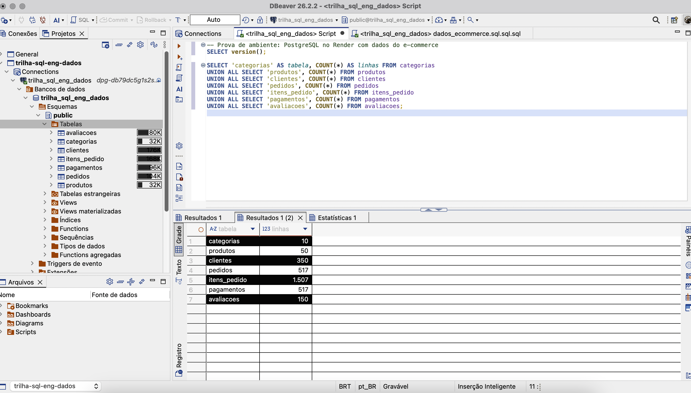

# Módulo 01 – Introdução: configurando o ambiente

Ambiente montado em 13/10/2026: **PostgreSQL no Render** + **DBeaver** no macOS.

## O que foi feito
1. Banco PostgreSQL criado no Render (plano free).
2. DBeaver instalado e conexão criada.
3. Script `database/dados_ecommerce.sql` executado (7 tabelas: categorias, produtos, clientes, pedidos, itens_pedido, pagamentos, avaliacoes).
4. Verificação com `SELECT version();` e contagem de linhas por tabela.

## Dados de conexão (modelo – sem credenciais)
| Campo | Valor |
|---|---|
| Host | `dpg-XXXXXXXX-a.oregon-postgres.render.com` (sempre começa com `dpg-`) |
| Porta | `5432` |
| Banco | `trilha_sql_eng_dados` |
| SSL | modo `require` |

> ⚠️ Nunca publicar usuário/senha no GitHub. Use o **External Database URL** do Render apenas localmente.

## Problemas que encontrei e como resolvi
| Erro | Causa | Solução |
|---|---|---|
| `No suitable driver found for jdbc:postgresql://...` | Driver JDBC não baixado/carregado no DBeaver | Gerenciador de driver → PostgreSQL → Bibliotecas → *Baixar/Atualizar*; se persistir, mover `drivers.xml` e a pasta `drivers` de `~/Library/DBeaverData` para backup e deixar o DBeaver baixar de novo |
| `FATAL: No SNI information found` | **Host digitado sem o prefixo `dpg-`**; o Render usa o nome do host (SNI) para achar o banco | Copiar o host completo do External Database URL |
| `sslfactory ... não pôde ser instanciado` | Propriedade `sslfactory` vazia/errada nas Propriedades do driver | Recriar a conexão sem mexer nas propriedades do driver; SSL = `require` |
| Aba SSH ativa com "Hostname is not specified" | Túnel SSH habilitado sem host | Remover a aba SSH |
| Tabelas não apareciam | Script rodado com Cmd+Enter (só 1 comando) | Executar o script inteiro com **Cmd+Option+X** e atualizar com F5 |

Teste de rede útil: `nc -vz <host> 5432`. Teste direto no terminal: `psql "host=<host> port=5432 dbname=trilha_sql_eng_dados user=<usuario> sslmode=require"`.

## Evidência
Banco PostgreSQL (Render) conectado no DBeaver, com a contagem de linhas de cada tabela do e-commerce:

